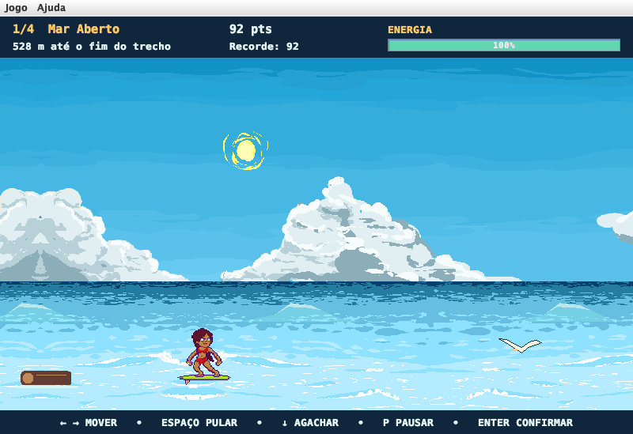

# Lost in the Waves

Jogo retrô de plataforma/sobrevivência feito em **Java Swing**, organizado em **MVC**,
com a janela principal construída no **WindowBuilder** (Eclipse).
Trabalho G2 de Programação Orientada a Objetos.

Uma onda derruba a surfista, que perde a costa de vista e precisa atravessar
o oceano para encontrar a areia.



## Como executar

### Eclipse (com WindowBuilder)

1. `File > Import > General > Existing Projects into Workspace` e selecione a pasta `LostInTheWaves`.
2. Execute `src/app/Main.java` (`Run As > Java Application`).
3. Para editar a tela no WindowBuilder: botão direito em `src/view/TelaPrincipal.java` >
   `Open With > WindowBuilder Editor` > aba **Design**.

### Terminal (JDK 17 ou superior)

```bash
javac -d bin $(find src -name "*.java") && cp -R src/assets bin/ && java -cp bin app.Main
```

## Controles

| Tecla | Ação |
| --- | --- |
| Enter | Começar, avançar a história, próxima fase, tentar novamente |
| ← / → (ou A / D) | Mover |
| Espaço / ↑ (ou W) | Pular |
| ↓ (ou S) | Segurar para agachar e passar sob as gaivotas |
| P | Pausar ou continuar |

O menu **Jogo** tem Novo jogo, Pausar/Continuar, Menu principal e Sair.
O menu **Ajuda** mostra os controles e os créditos.

## Regras

- 4 fases de 600 m: **Mar Aberto**, **Águas Perigosas**, **Tempestade** e **A Última Onda**.
  Cada fase é mais rápida que a anterior e a praia aparece no fim da última.
- Colidir com um obstáculo tira 25 de energia. Com energia 0 é **game over**; ao tentar
  de novo, a fase recomeça com energia cheia e a pontuação do início da fase.
- Chegar à praia na última fase é a **vitória**: na cena final animada ela surfa do horizonte
  até a beira, pula da prancha para a areia, caminha até a toalha e comemora.
- Pontuação: distância percorrida, desvios (com bônus de combo), moedas (100) e bola de praia (250).
- Itens: **coco** (+25 energia), **água** (+15 energia), **moeda**, **bola de praia** e
  **escudo** (absorve um impacto ou expira após ~6 s).
- Obstáculos: rocha, boia, tronco, gaivota (voa baixo, com sombra na água: agache para
  passar por baixo), tubarão (mais rápido), baleia, onda (quebrando, com espuma e
  respingos animados) e redemoinho (puxa a surfista para o centro).
- Agachar dobra as pernas e abaixa o tronco sobre a prancha, reduzindo a altura da colisão.
- Prólogo animado em 3 cenas: a surfista no mar, a onda gigante que a derruba (ela gira
  no ar e a prancha voa longe) e ela nadando de volta e subindo na prancha.

## Estrutura (MVC)

```
src/
├── app/
│   └── Main.java              monta model + view + controller e inicia o jogo
├── model/                     regras do jogo (não conhece Swing)
│   ├── GameModel.java         estado da partida, game loop, fases, energia, vitória/derrota
│   ├── GameState.java         TITLE, INTRO, PLAYING, PAUSED, LOST, ROUTE, WON
│   ├── GameObject.java        classe abstrata base (posição, tamanho, colisão)
│   ├── Surfer.java            personagem do jogador (movimento, pulo, agachar)
│   ├── Obstacle.java          obstáculo abstrato + fábrica
│   ├── Rock, Buoy, Log, Gull, Shark, Whale, Wave, Whirlpool   obstáculos concretos
│   ├── ObstacleType.java      tipos de obstáculo
│   ├── Item.java / ItemType.java   itens coletáveis e seus efeitos
│   ├── Stage.java             dados de cada fase
│   ├── ScoreManager.java      pontos, combo e recorde
│   └── CollisionManager.java  regras de colisão
├── view/                      interface gráfica
│   ├── TelaPrincipal.java     JFrame do WindowBuilder: menu, HUD e painel do jogo
│   ├── GamePanel.java         JPanel que desenha o jogo (paintComponent)
│   ├── SpriteRenderer.java    desenho dos obstáculos e itens
│   └── Assets.java            carregamento das imagens
├── controller/
│   └── GameController.java    ActionListener (Timer e menus) + KeyListener (teclado)
└── assets/                    imagens do jogo
```

**Fluxo:** o `javax.swing.Timer` do `GameController` dispara a cada 16 ms →
o controller repassa as teclas para o `GameModel` e chama `update()` →
o model move objetos, verifica colisões e pontuação → o controller atualiza o HUD
da `TelaPrincipal` e pede `repaint()` ao `GamePanel`, que desenha o estado atual do model.

Conceitos de POO aplicados: **herança** (`GameObject` → `Surfer`, `Item`, `Obstacle` → obstáculos),
**polimorfismo** (`getSpeedBonus()`, `interact()` e `getBounds()` sobrescritos),
**classes abstratas**, **encapsulamento** (atributos privados com getters),
**enums** e separação de responsabilidades com MVC.

## Créditos da arte

A prancha, a areia, a palmeira e o caranguejo vêm do **High Tides Basic Pack**,
de **Kanpelle** (https://kanpelle.itch.io/). Termos em `LICENCA_HIGH_TIDES.txt`.
